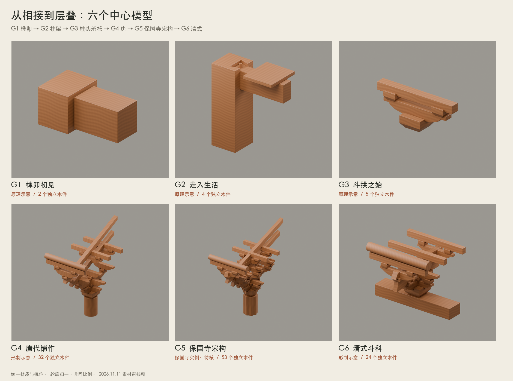
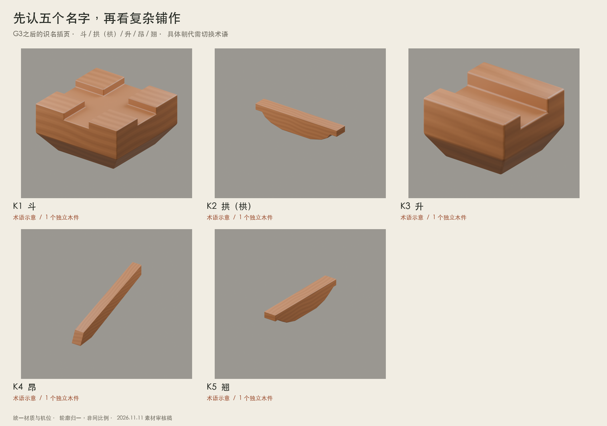

# 第一幕三维素材包

2026-11-11 · 素材审核版。六段历史中心模型＋五个术语独立模型；现有网页未接入。

| ID | 模型 | 木件数 | 装配事件数 | GLB大小 | 工程 | 渲染 |
|---|---|---:|---:|---:|---|---|
| G1 | 榫卯初见 | 2 | 2 | 0.89 MB | [G1.blend](G1_榫卯初见/G1.blend) | [查看](G1_榫卯初见/render.png) |
| G2 | 走入生活 | 4 | 4 | 0.91 MB | [G2.blend](G2_走入生活/G2.blend) | [查看](G2_走入生活/render.png) |
| G3 | 斗拱之始 | 5 | 4 | 0.91 MB | [G3.blend](G3_斗拱之始/G3.blend) | [查看](G3_斗拱之始/render.png) |
| G4 | 唐代铺作 | 32 | 10 | 1.14 MB | [G4.blend](G4_唐代铺作/G4.blend) | [查看](G4_唐代铺作/render.png) |
| G5 | 保国寺宋构 | 53 | 12 | 1.36 MB | [G5.blend](G5_保国寺宋构/G5.blend) | [查看](G5_保国寺宋构/render.png) |
| G6 | 清式斗科 | 24 | 8 | 1.07 MB | [G6.blend](G6_清式斗科/G6.blend) | [查看](G6_清式斗科/render.png) |
| K1 | 斗 | 1 | 1 | 0.89 MB | [K1.blend](K1_斗/K1.blend) | [查看](K1_斗/render.png) |
| K2 | 拱（栱） | 1 | 1 | 0.88 MB | [K2.blend](K2_拱栱/K2.blend) | [查看](K2_拱栱/render.png) |
| K3 | 升 | 1 | 1 | 0.89 MB | [K3.blend](K3_升/K3.blend) | [查看](K3_升/render.png) |
| K4 | 昂 | 1 | 1 | 0.88 MB | [K4.blend](K4_昂/K4.blend) | [查看](K4_昂/render.png) |
| K5 | 翘 | 1 | 1 | 0.88 MB | [K5.blend](K5_翘/K5.blend) | [查看](K5_翘/render.png) |

## 每组交付

- `.blend`：可编辑原生模型，构件独立，帧1组合、80分离观察、140回到组合。分离图不是历史施工顺序。
- `.glb`：导出当前组合状态，含独立对象、材质、构件标识。已使用Draco，后续网页需加载本地解码器。
- `render.png`：固定同一机位的组合渲染；六个G组另有`exploded.png`，拆解观察图保持方向、单独调整取景以避免裁切。
- `assembly.json`：中文名称、稳定ID、教学落位顺序、依赖、起始偏移、最终位姿、类型、来源和待核项。
- `validation.json`：几何检查。总体验证见`verification-report.json`。

## 统一规范

1. 全套共用 `WOOD_SHARED_v1`，原创1024木纹在 `shared/wood_basecolor_1024.png`，材质库为`shared/WoodMaterial.blend`。纹理已嵌入各GLB和工程。
2. Blender Z向上；GLB与JSON为Y向上，换算[x,z,-y]。模型归一后围绕同一原点，根节点用于整组进退场。
3. 固定正交机位；每组单独做轮廓归一，不是实测同比例比较。GLB里的米仅为工作单位。
4. 画面审核采用统一中性背景；网页纸色由后续页面设置。保持素木是视觉比较策略，不还原各建筑历史彩画。
5. G4/G5/G6分别构建，有不同构件排布、出跳与昂形。G4非佛光寺测绘复原，G6非太和殿特定檐层复原；G5是保国寺实例目标、待核形制。

## 对04数量预算的调整

全套保留125个独立木件，其中六个历史模型120件、识名5件。没有为凑18—24件而把多个木件合并。装配事件把可同步落位的关联件分组，木件数与事件数分别登记。各组GLB均小于3 MB；这不代表已验证网页帧率。

## 审核重点

G1/G2可见卯槽已切出，按元数据轴向插入。G3是承托原理。唐宋清的精确尺寸、局部接合、横栱层位和史料仍待核；隐藏榫卯未制作，不据此生产实物或演示真实结构受力。

[对应图文资料](../materials-text-image/README.md) · [修订与审核清单](../planning/05-素材准备-修订与审核清单.md)