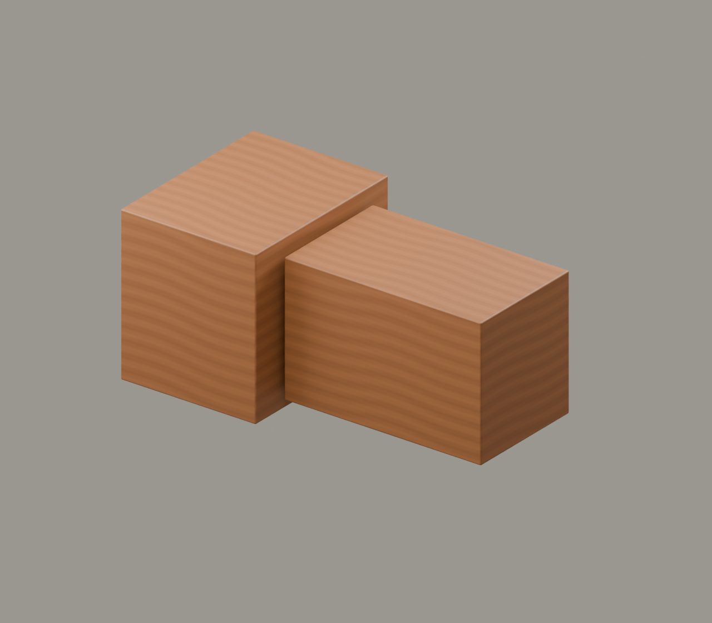

# G1｜榫卯初见

素材审核稿 · 2026-11-11 · 原理示意

## 上屏文案

**木头怎样握住另一块木头？**

木件凸出的部分是榫，容纳它的凹口是卯。河姆渡出土木构件保存了多种榫卯形态。眼前用通用节点，观察两块木头如何对位、插合。

**先看连接，再看层层承托。**

年代角标：河姆渡文化，距今约7000—5000年

## 中心画面与装配

先展示卯口，再让榫件沿轴向插合；停留时能看见榫肩。

[Blender工程](../../materials-3d/G1_榫卯初见/G1.blend) · [GLB](../../materials-3d/G1_榫卯初见/G1.glb) · [分离图](../../materials-3d/G1_榫卯初见/exploded.png) · [装配资料](../../materials-3d/G1_榫卯初见/assembly.json)

各构件独立；同色共用一套木材。模型使用轮廓归一展示，非同比例，尺寸是工作比例。教学落位顺序待构造校核，不宣称真实施工顺序。

## 图片与史实边界

河姆渡梁头榫实物与本模型不是同一器物。

需要补齐原件多视图后，才另建器物复原模型。

## 来源

- [中国国家博物馆｜远古江南·海陆山河——河姆渡文化发现50周年考古成果特展](https://www.chnmuseum.cn/portals/0/web/zt/202311hmdwh/)：河姆渡文化年代、梁头榫实物、干栏建筑背景。 限制：并不能证明本轮G1/G2虚拟节点对应某件出土器物。

图片登记见本目录 `image-register.json`；自制渲染图不能作为史实证据图。未授权馆方图与转载图仅供内部参考。
