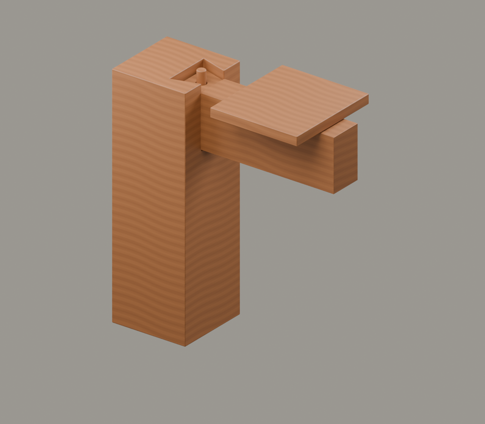

# G2｜走入生活

素材审核稿 · 2026-11-11 · 原理示意

## 上屏文案

**一个节点，怎样连起房屋？**

当柱、梁和楼板相接，分散的木件开始组成房屋。干栏建筑将居住面架离地面；这里以通用节点，说明建筑如何通过连接组织成整体。

**从两块木头，走向一座房屋。**

年代角标：早期木构背景，不给虚拟节点指定年代

## 中心画面与装配

柱就位→梁的燕尾榫从顶开口下插→木销→楼板；轴向应照metadata，不侧向穿过卯壁。

[Blender工程](../../materials-3d/G2_走入生活/G2.blend) · [GLB](../../materials-3d/G2_走入生活/G2.glb) · [分离图](../../materials-3d/G2_走入生活/exploded.png) · [装配资料](../../materials-3d/G2_走入生活/assembly.json)

各构件独立；同色共用一套木材。模型使用轮廓归一展示，非同比例，尺寸是工作比例。教学落位顺序待构造校核，不宣称真实施工顺序。

## 图片与史实边界

燕尾、木销、楼板组合属于本轮设计的原理模型，不是考古复原。

尚缺可用于对应节点的干栏发掘或复原图，因此证据角标先不上图。

## 来源

- [中国国家博物馆｜远古江南·海陆山河——河姆渡文化发现50周年考古成果特展](https://www.chnmuseum.cn/portals/0/web/zt/202311hmdwh/)：河姆渡文化年代、梁头榫实物、干栏建筑背景。 限制：并不能证明本轮G1/G2虚拟节点对应某件出土器物。

图片登记见本目录 `image-register.json`；自制渲染图不能作为史实证据图。未授权馆方图与转载图仅供内部参考。
