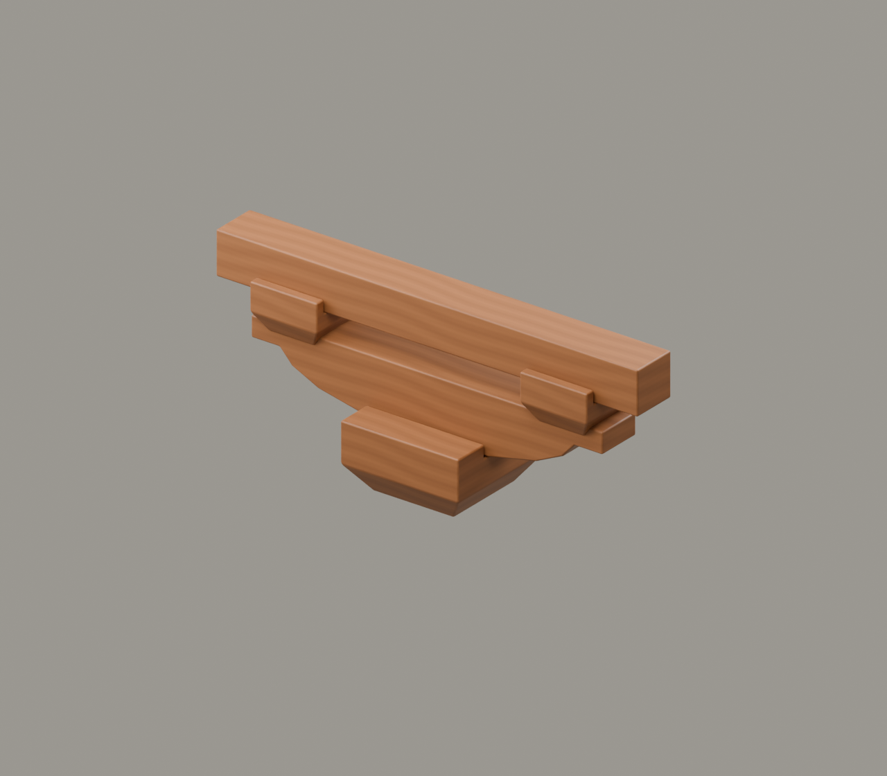

# G3｜斗拱之始

素材审核稿 · 2026-11-11 · 原理示意

## 上屏文案

**柱头上，为何多了一层木件？**

汉代陶楼等明器上，可以看到斗拱的形象。这里用一斗、横栱、两只小斗和短枋，演示柱头承托的基本关系；不把陶制形象当作完整木构实录。

**连接向上，形成层叠承托。**

年代角标：东汉陶楼形象背景，公元25—220年

## 中心画面与装配

大斗→横栱→两端小斗→短枋；五件均独立。

[Blender工程](../../materials-3d/G3_斗拱之始/G3.blend) · [GLB](../../materials-3d/G3_斗拱之始/G3.glb) · [分离图](../../materials-3d/G3_斗拱之始/exploded.png) · [装配资料](../../materials-3d/G3_斗拱之始/assembly.json)

各构件独立；同色共用一套木材。模型使用轮廓归一展示，非同比例，尺寸是工作比例。教学落位顺序待构造校核，不宣称真实施工顺序。

## 图片与史实边界

本组叫“柱头承托原理”，不把“一斗二升”作为已证实的汉代标准名称。

陶楼图只能支持出现斗拱形象；熊形栱、隐藏节点未复原。

## 来源

- [河南博物院｜绿釉三层陶楼](https://www.chnmus.net/sitesources/hnsbwy/page_pc/dzjp/zpjc/tq/article7b37de012be44686ac39588368ed3dd8.html)：东汉陶楼及熊形栱等形象。 限制：馆图335×508，细部有限；G3不复原熊形栱，不据此断言汉代统一节点。

图片登记见本目录 `image-register.json`；自制渲染图不能作为史实证据图。未授权馆方图与转载图仅供内部参考。
