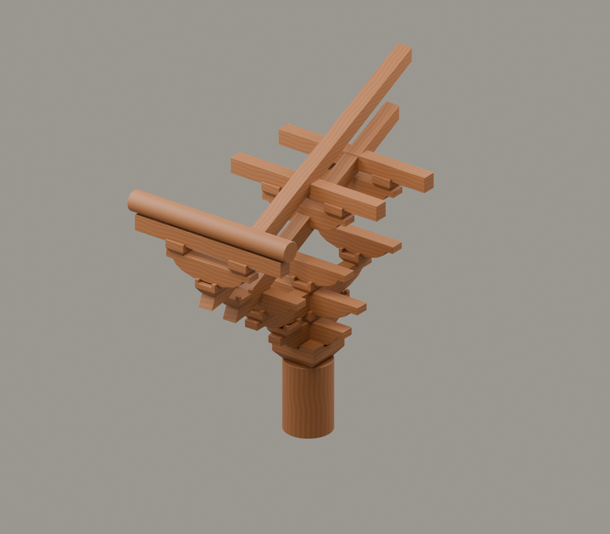

# G4｜唐代铺作

素材审核稿 · 2026-11-11 · 形制示意

## 上屏文案

**托架怎样连成一层框架？**

以唐代佛光寺东大殿为观察背景，斗拱已与梁枋共同组织檐下构架。中心模型保留出跳、长昂和横向联系，用简化形制观察这层木构的空间关系。

**由柱头承托，走向构架联系。**

年代角标：唐·857年，佛光寺东大殿背景

## 中心画面与装配

粗壮栱材与长昂独立构建；横向枋作为构架联系的截段。

[Blender工程](../../materials-3d/G4_唐代铺作/G4.blend) · [GLB](../../materials-3d/G4_唐代铺作/G4.glb) · [分离图](../../materials-3d/G4_唐代铺作/exploded.png) · [装配资料](../../materials-3d/G4_唐代铺作/assembly.json)

各构件独立；同色共用一套木材。模型使用轮廓归一展示，非同比例，尺寸是工作比例。教学落位顺序待构造校核，不宣称真实施工顺序。

## 图片与史实边界

不写“唐代都高达柱身一半”“出檐都达三四米”。与宋清均为轮廓归一，不可比量绝对尺寸。

缺同一柱头完整正投影、各层横栱与后尾支承数据；当前不能冠“佛光寺精确模型”。

## 来源

- [张荣、刘畅等；故宫博物院院刊｜佛光寺东大殿实测数据解读（论文首页）](https://www.dpm.org.cn/Uploads/pdf/5075/T00028_00.pdf)：857年、实测研究及下昂斜度研究。 限制：仅取得首页，未取得完整测绘图；模型不得称精确复原。
- [故宫博物院院刊（全文书目信息待补）｜佛光寺研究论文单页：屋架比例与下昂角度](https://www.dpm.org.cn/Uploads/File/pdf/9e/dc/5d/9edc5d81a97c78e43173912d114a38dc.pdf)：下昂与屋架斜度关系的研究线索。 限制：只取得单页，不以此宣称完成全部构件校核。
- [G41rn8｜Wutai 2009 492.jpg](https://commons.wikimedia.org/wiki/File:Wutai_2009_492.jpg)：佛光寺东大殿檐下转角环境。 限制：是转角照片，不能当柱头铺作的逐件依据。

图片登记见本目录 `image-register.json`；自制渲染图不能作为史实证据图。未授权馆方图与转载图仅供内部参考。
