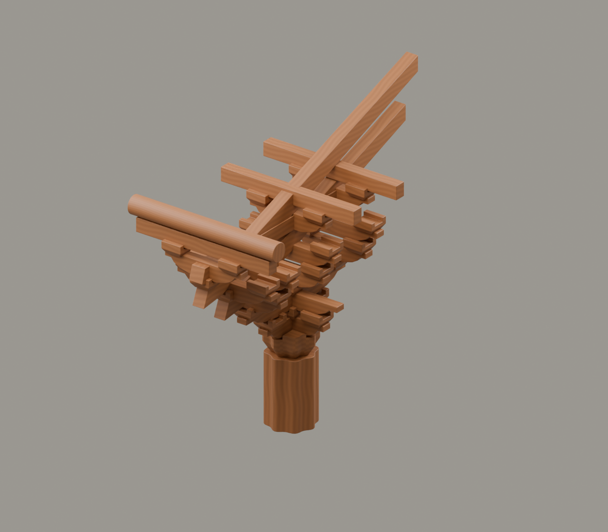

# G5｜保国寺宋构

素材审核稿 · 2026-11-11 · 保国寺实例·待核

## 上屏文案

**在保国寺，读懂层层铺作。**

保国寺大殿建于1013年，前檐柱头铺作有双杪双下昂、第一跳偷心等特点。将它与1103年刊行的《营造法式》对读，可以观察实物与制度的联系。

**从一座实物，读懂营造规矩。**

年代角标：北宋·1013年；1103年《营造法式》刊行

## 中心画面与装配

先柱头与八瓣栌斗，再双杪、双下昂、横栱与上承构件；八瓣描边只作后续前端设计说明。

[Blender工程](../../materials-3d/G5_保国寺宋构/G5.blend) · [GLB](../../materials-3d/G5_保国寺宋构/G5.glb) · [分离图](../../materials-3d/G5_保国寺宋构/exploded.png) · [装配资料](../../materials-3d/G5_保国寺宋构/assembly.json)

各构件独立；同色共用一套木材。模型使用轮廓归一展示，非同比例，尺寸是工作比例。教学落位顺序待构造校核，不宣称真实施工顺序。

## 图片与史实边界

保国寺早于《营造法式》，不能写成照书营建；“最完整”“唯一”不进入本版文案。

瓜瓣栌斗为轮廓近似；尺寸、横栱层位、昂尾与内柱关系待测绘校核。

## 来源

- [良渚博物院展览教育部｜觅古在杭城——北京大学2017年中学生考古暑期课堂第六天实况报道](https://www.lzmuseum.cn/jgwmg/detail.aspx?artid=2024)：保国寺1013年、双杪双下昂七铺作与一跳偷心。 限制：实地讲解记录，不提供各木件精确尺寸。
- [故宫博物院｜《营造法式》](https://www.dpm.org.cn/ancient/mingqing/149329.html)：1103年刊行及版本信息。 限制：本轮未使用书页作背景，也不声称保国寺按此书施工。
- [本地转载图，原书与作者待查｜保国寺铺作.jpg](local:research/斗拱可视化资料/保国寺铺作.jpg)：保国寺侧向形制参考。 限制：只作内部建模参考，不能替代测绘。
- [用户提供；拟署名待确认｜现场木构模型照片](local:research/保国寺实地调研照片/37f6b9701sd1af240159492ef45c6f44.jpg)：展陈木构模型的空间联系。 限制：照片拍的是展陈模型，不是原构件。

图片登记见本目录 `image-register.json`；自制渲染图不能作为史实证据图。未授权馆方图与转载图仅供内部参考。
