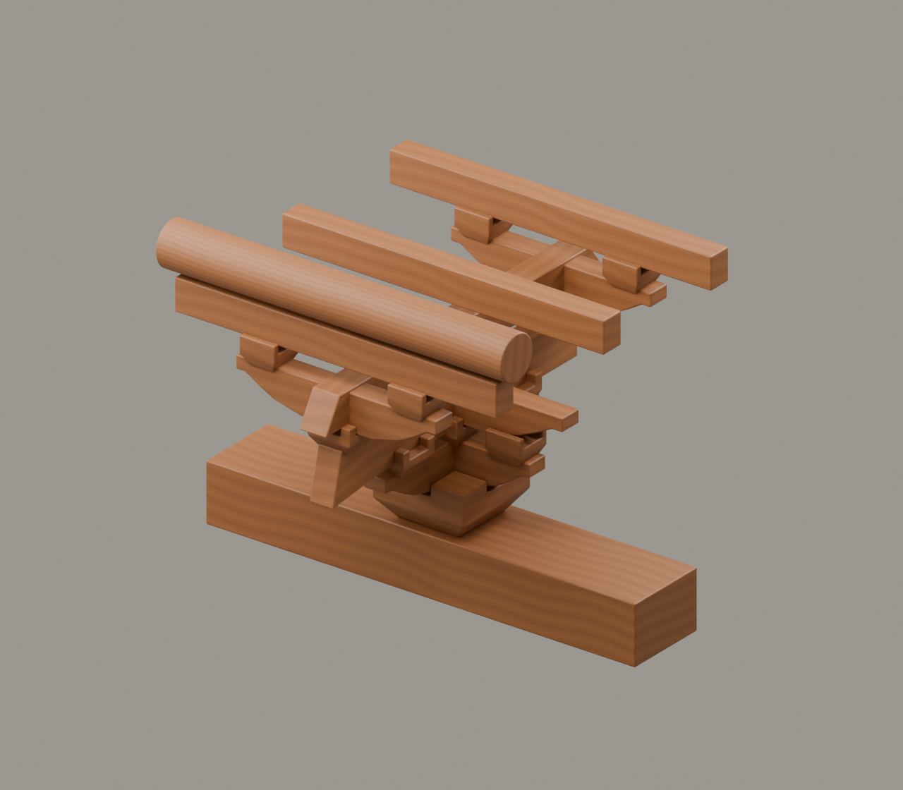

# G6｜清式斗科

素材审核稿 · 2026-11-11 · 形制示意

## 上屏文案

**形制变化，作用也在变化。**

进入明清，斗拱的尺度、布置和装饰表达发生变化，也形成以斗口为尺度的制度。结构作用随位置与做法而异，不能将清代斗拱一概说成不再承重。

**尺度与装饰改变，作用须分辨。**

年代角标：清式语境；不指定太和殿某一檐层

## 中心画面与装配

平板枋→坐斗→翘→昂→厢栱与升→上承枋桁。清式昂用短昂嘴与平身区分于宋式长斜昂。

[Blender工程](../../materials-3d/G6_清式斗科/G6.blend) · [GLB](../../materials-3d/G6_清式斗科/G6.glb) · [分离图](../../materials-3d/G6_清式斗科/exploded.png) · [装配资料](../../materials-3d/G6_清式斗科/assembly.json)

各构件独立；同色共用一套木材。模型使用轮廓归一展示，非同比例，尺寸是工作比例。教学落位顺序待构造校核，不宣称真实施工顺序。

## 图片与史实边界

素木材质仅为了统一比较，不声称清代实例原本没有彩画。单攒不能证明“间距加密”。

尚缺太和殿明确檐层节点；故宫内檐照片仅供环境参考，不作这一外檐平身科的直接证据。

## 来源

- [故宫博物院｜斗栱千千万](https://www.dpm.org.cn/architectural_art/246282.html)：明清斗栱位置、斗口、装饰作用及仍具支撑作用。 限制：不能推出清代所有斗栱完全不承重。
- [沈阳故宫博物院｜古建保护常识·斗栱分件](https://www.sypm.org.cn/xinwen_2/1.html)：大斗、翘、昂、三才升等明清名称；明清柱头科仍有承重功能。 限制：术语单元注明清式语境；不把清式标准尺寸用于宋构。
- [故宫博物院｜太和殿](https://www.dpm.org.cn/explore/building/236465.html)：清代重建及整体建筑背景。 限制：未选定具体檐层的完整节点图，故G6降为清式教学示意。
- [The war moose｜Interlocking wooden brackets.jpg](https://commons.wikimedia.org/wiki/File:Interlocking_wooden_brackets.jpg)：故宫内檐装饰性斗栱的环境图。 限制：殿名未详；不是太和殿外檐平身科证据，不建议直接作G6的节点对照图。

图片登记见本目录 `image-register.json`；自制渲染图不能作为史实证据图。未授权馆方图与转载图仅供内部参考。
