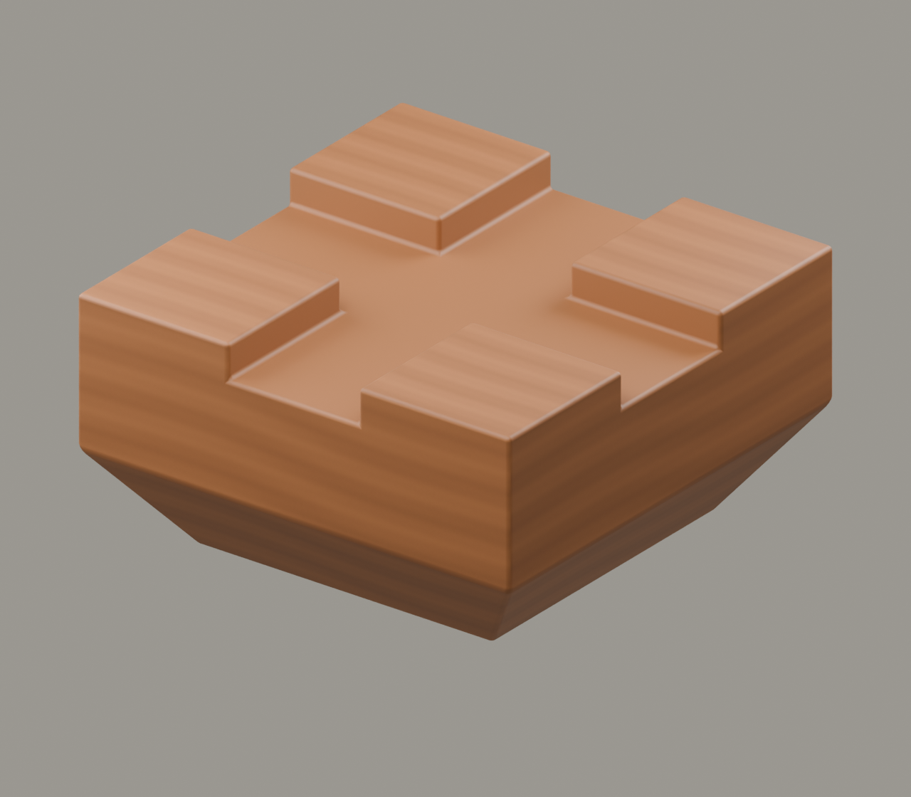
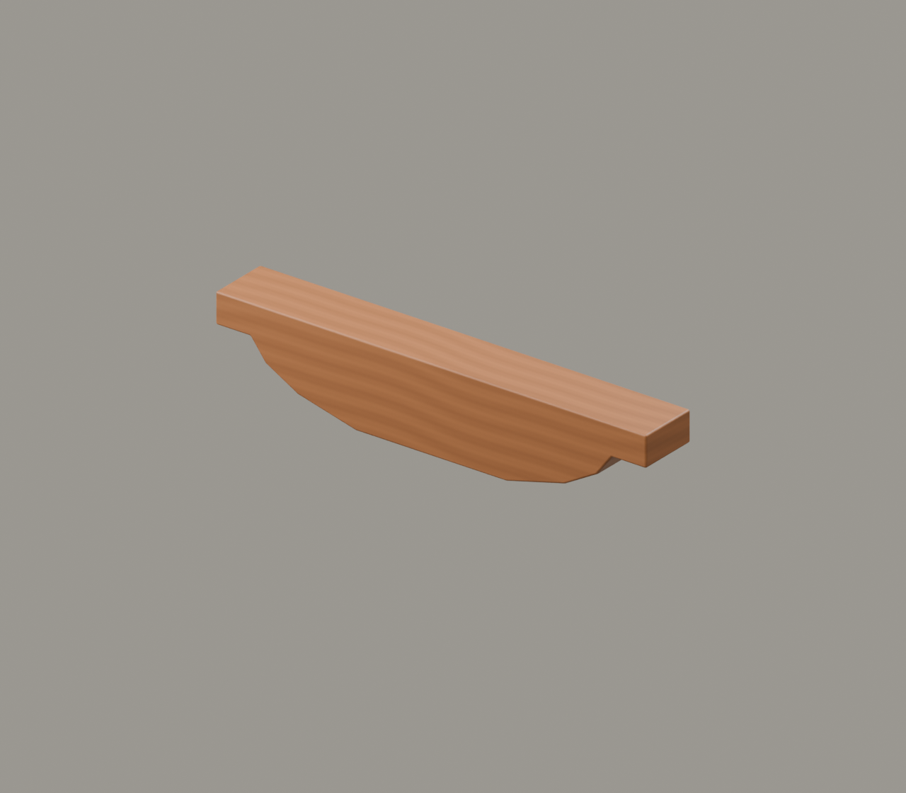
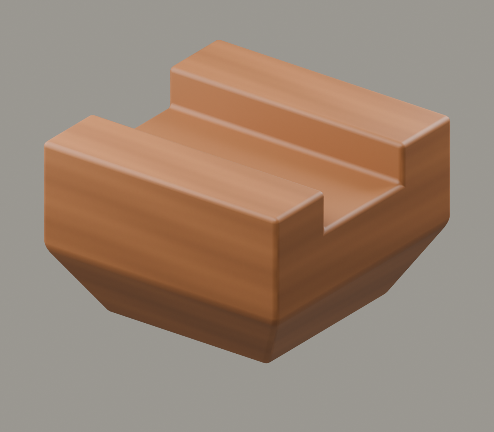
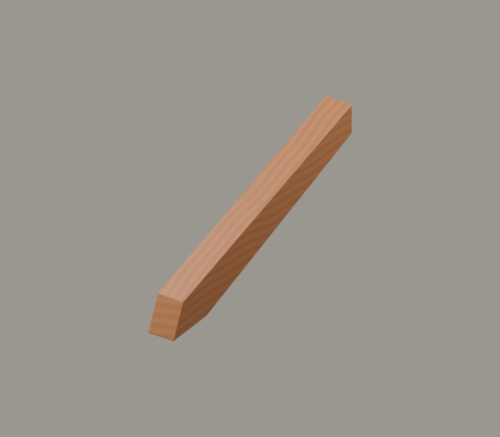
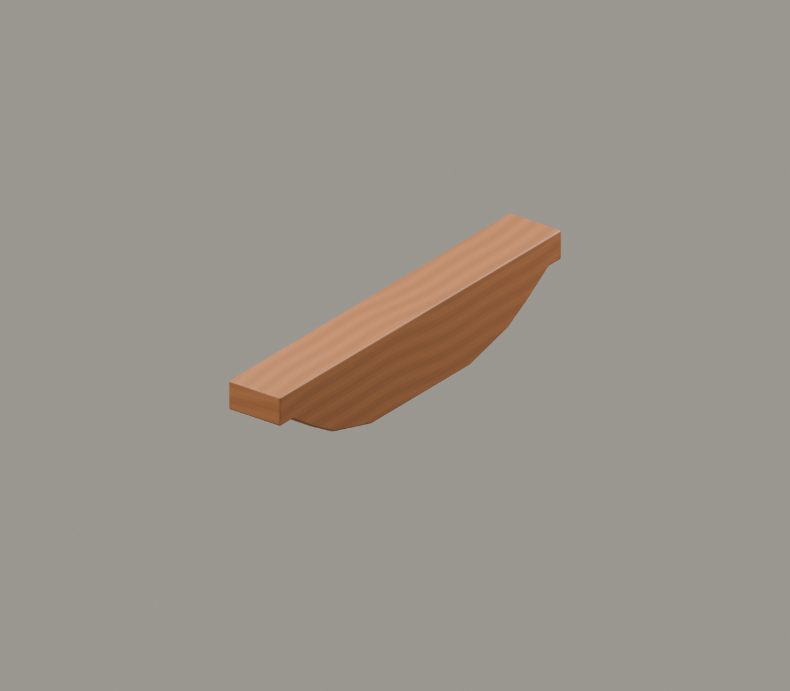

# K｜先认五个名字，再看复杂铺作

插入位置：G3之后、G4之前。作为识名插页，不新增历史朝代；年代标尺停在G3与G4之间。

保留中心舞台与同一机位，斗→拱→升→昂→翘依次单独居中。未来滚动路径由六个历史停留区扩展为六段＋识名插页，不能原样使用 p∈[0,6) 的六等分映射。

主文案：先认出木件，才能看懂组合。斗与升承担不同位置的承托，横栱与翘朝不同方向伸展，昂有独特的出挑形态。这里先用术语示意建立直觉，再回到具体时代辨认名称。

## 斗 · dǒu

上承木件的斗形承托块；此处用底部大斗作例子。

大斗不是全部斗类；宋式栌斗与清式坐斗须分语境。

[模型](../../materials-3d/K1_斗/K1.blend) · [GLB](../../materials-3d/K1_斗/K1.glb)

## 拱（栱） · gǒng

两端承托、外形近弓的长木件；此处示意沿面宽方向的横栱。

专业文字常写“栱”；不是石拱券，也不以曲线越弯越典型。

[模型](../../materials-3d/K2_拱栱/K2.blend) · [GLB](../../materials-3d/K2_拱栱/K2.glb)

## 升 · shēng

较小的斗形构件；此处用清式栱端三才升作例子，承接上层木件。

升属于斗形构件，不是与“斗”完全无关的第五类；宋构按散斗等具体名称讲。

[模型](../../materials-3d/K3_升/K3.blend) · [GLB](../../materials-3d/K3_升/K3.glb)

## 昂 · áng

向檐外伸出的构件，外端可斜下；本件用斜昂示意方向与轮廓。

历代昂的形态和作用不同，清式昂嘴不能直接当宋式长斜昂。

[模型](../../materials-3d/K4_昂/K4.blend) · [GLB](../../materials-3d/K4_昂/K4.glb)

## 翘 · qiáo

清式称谓：与横栱垂直、朝出檐方向伸出的弓形构件。

宋式相应语境称华栱；识名后在宋段切换称谓，不混用尺寸制度。

[模型](../../materials-3d/K5_翘/K5.blend) · [GLB](../../materials-3d/K5_翘/K5.glb)

## 依据

[沈阳故宫博物院：古建保护常识·斗栱分件](https://www.sypm.org.cn/xinwen_2/1.html)、[故宫博物院：昂](https://www.dpm.org.cn/lemmas/241883.html)。本单元以明清常用称谓作入门，宋段改用对应的宋式名称。